# PoshanSetu — PS.OS1 prototype

**An early-warning, consent and continuity layer for the Poshan Tracker.**
Techfest 2026-27 · The India @ 71/100 Challenge · Theme 1 (Maternal & Early Childhood Nutrition) · Team 7 · Round 2 prototype.

> Do not wait for a child to cross a line. Watch which way the child is heading, and act while recovery is still simple.

This repository is a working prototype of the Round 1 proposal. It also answers, in code, the five stress-tests raised after Round 1 (score 87/100). It runs as a desktop app (Electron) and as a static web build. **All child records are synthetic.**

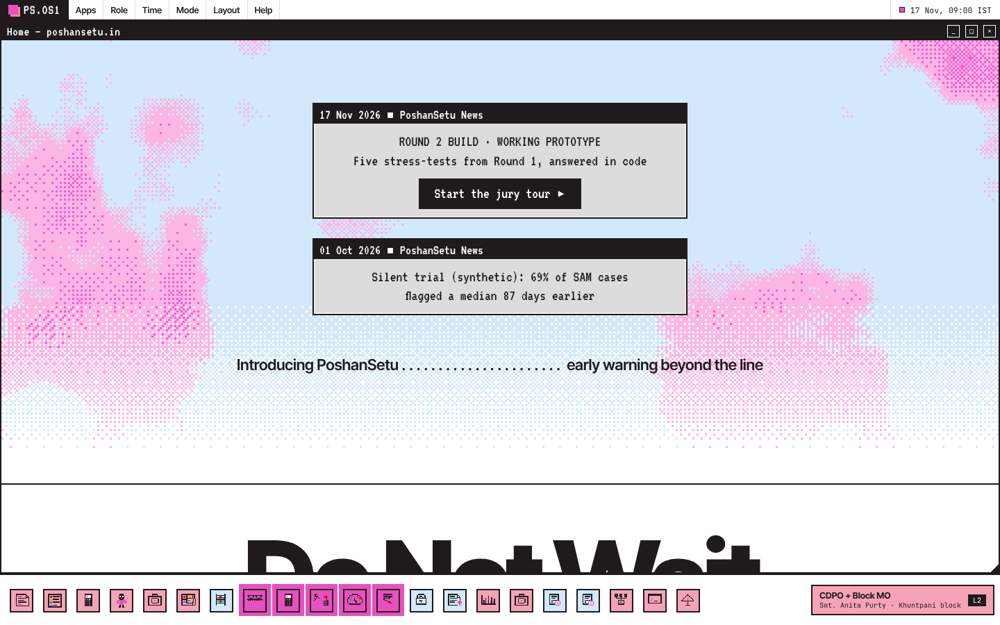

| | |
|---|---|
| 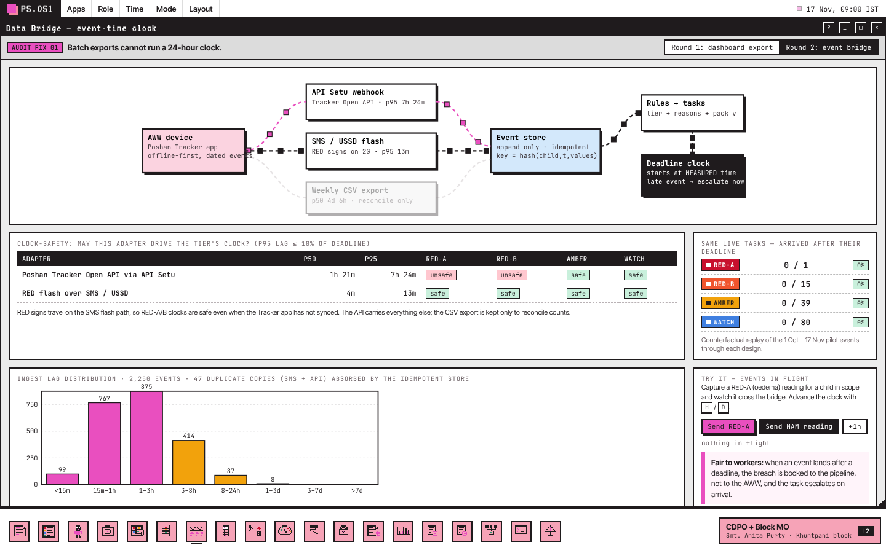 **Fix 01** event bridge | 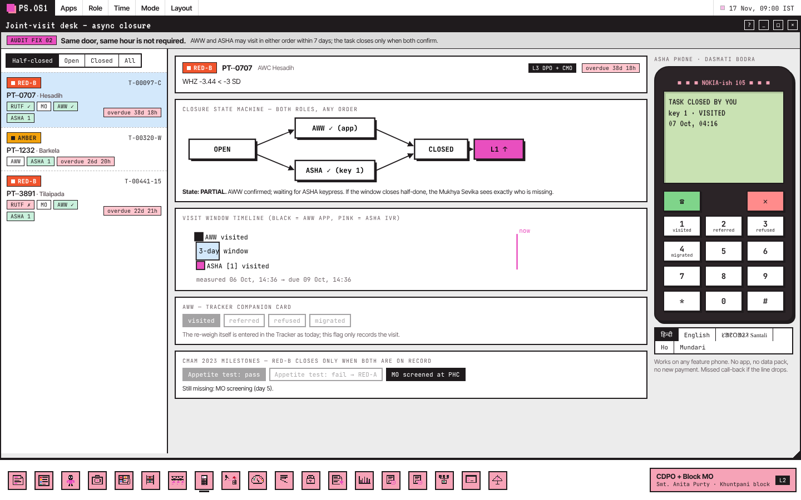 **Fix 02** async joint visit + IVR |
| 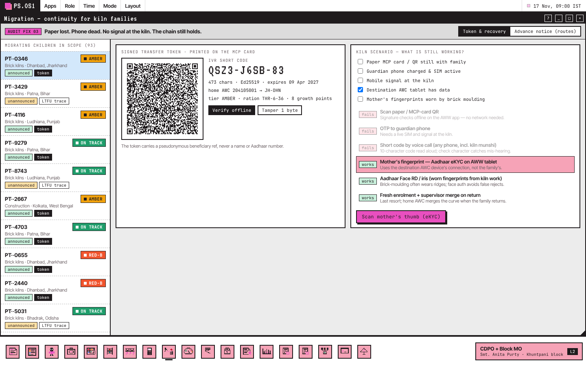 **Fix 03** kiln-proof token | 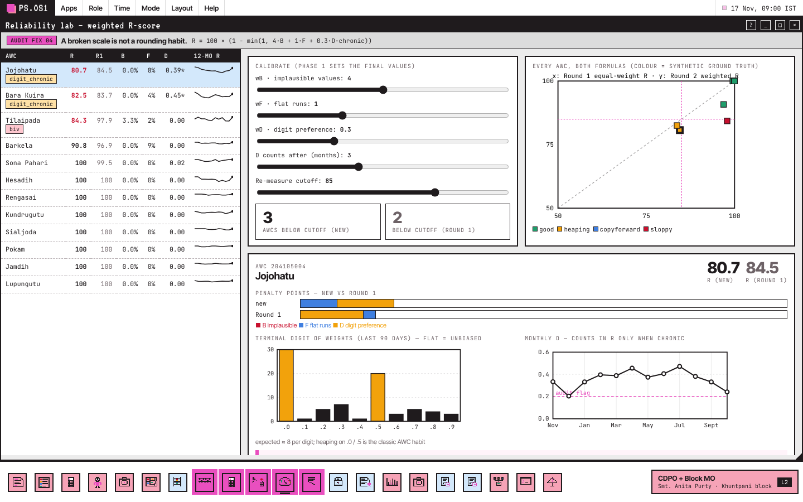 **Fix 04** weighted R-score |
| 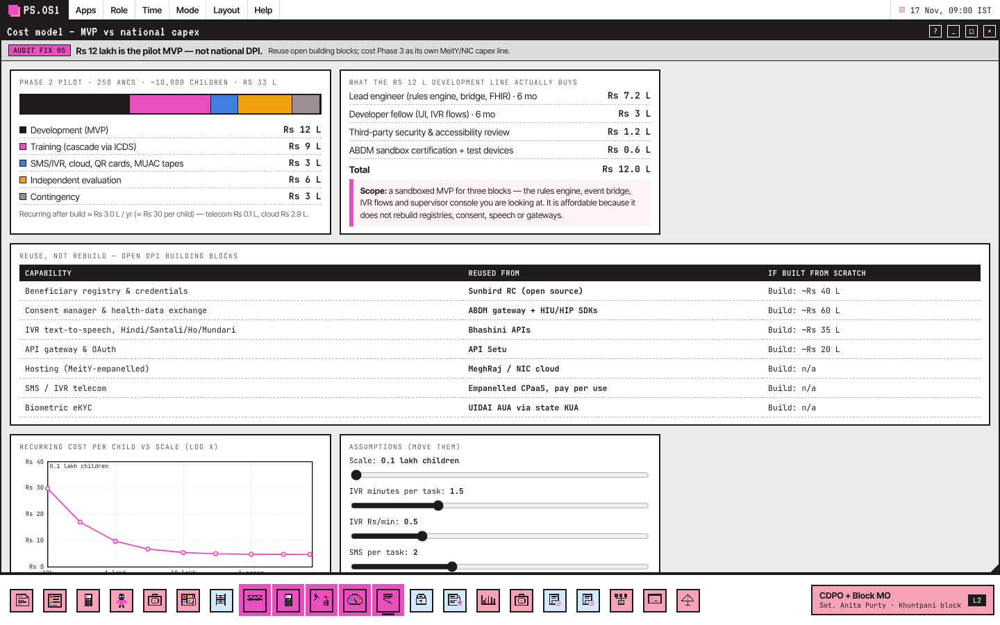 **Fix 05** honest cost model | 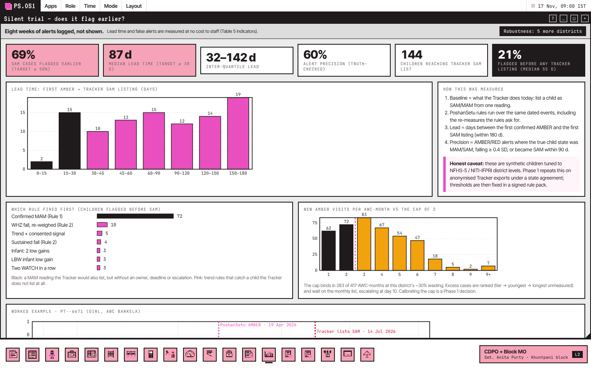 Silent-trial backtest |
| 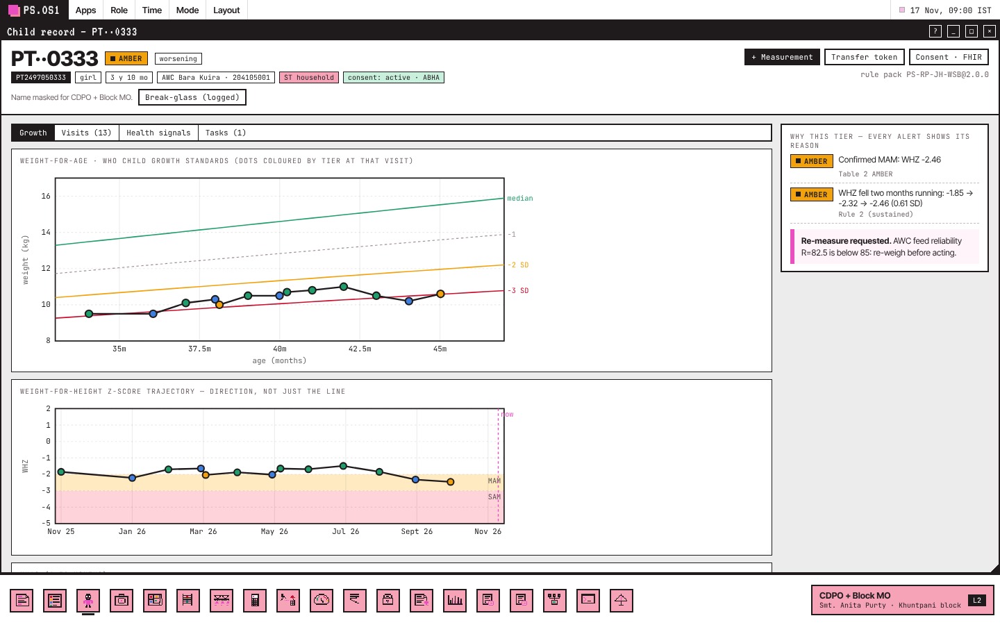 Child record | 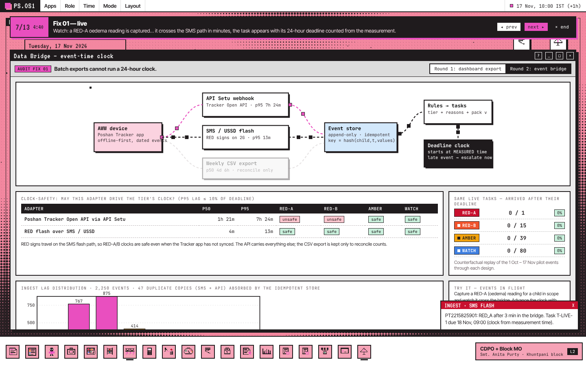 Jury tour presenter mode |
| 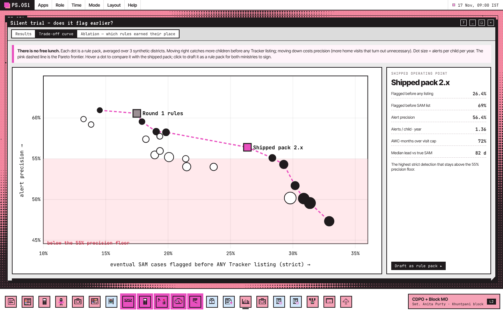 Precision–detection trade-off curve | 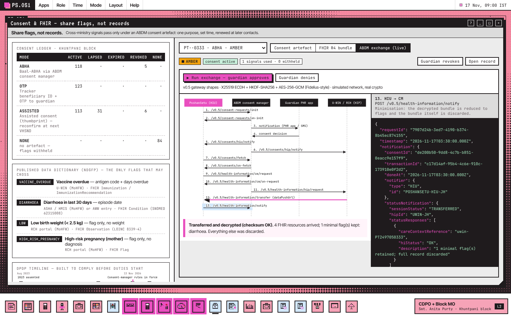 ABDM HIE consent + encrypted transfer |
| 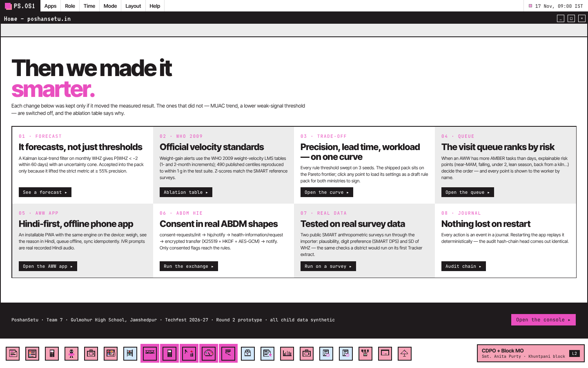 Round 2 depth, each card opens its proof | 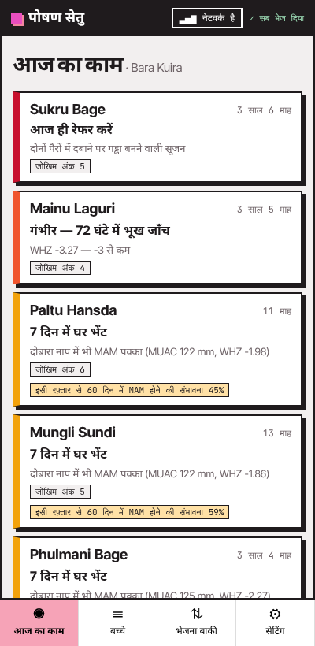 Hindi-first offline AWW app (PWA) |

---

## Run it

```bash
npm install
```

```bash
npm start            # Electron desktop app (PS.OS1)
```

```bash
npm run serve        # same app in a browser: http://localhost:5173
```

```bash
npm test             # engine tests (WHO z-scores, rules, closure, escalation, tokens, R-score, consent, audit)
```

```bash
npm run typecheck    # TypeScript checks the engine's JSDoc types (no build step)
```

```bash
npm run pwa          # companion service + AWW phone app at http://<LAN-IP>:8080/pwa/ (open on a phone on the same Wi-Fi)
```

```bash
npm run build:tradeoff   # re-run the threshold sweep and ablation behind the Trade-off curve (3 seeds)
```

```bash
npm run smoke        # with `npm run serve` running: every window × every role + live interactions in Chromium
```

```bash
npm run dist:win     # Windows x64 folder build in dist/ (also dist:linux, dist:mac)
```

CI runs the type check, the tests and the Chromium smoke test on every push. Pushing a `v*` tag builds the Windows package on GitHub Actions and attaches the zip to the release (`.github/workflows/windows.yml`).

On Windows, after `npm run dist:win`, double-click `dist\PoshanSetu-win32-x64\PoshanSetu.exe`. Copy that whole folder to the presentation laptop; it runs fully offline. The app adds `--no-sandbox` by itself when started as root on Linux.

Deep links: `#story` for Riya's story, `#worklist`, `#bridge`, `#joint`, `#migration`, `#reliability`, `#budget`, `#trial`, `#arch`, or `#jury` for presenter mode.

## Start here

The app opens with a **Start here** screen: four big buttons in plain words (show me everything · add children's weights · who needs a visit today · Riya's story). Press **h** to bring it back any time.

## Simple words in every window

Every window opens with a yellow **In simple words** strip: what the window is in one line, how to read it, and **Try** buttons that press the main controls for you. **What do these words mean?** explains the jargon on that screen (WHZ, MUAC, SAM, MAM, AWC…); **Help → What do the words mean?** lists them all. Experts can turn the strips off in **Mode → Simple words in every window**.

## Guided demo (easiest way to present)

Press **`g`** (or **Layout → Guided demo**, or the **Start the guided demo** button on Home). It has 63 steps in 14 chapters covering every window and every chart, written in simple words to read aloud. Each step opens the right window, sets the right role, clicks what needs clicking and draws a pink ring around what the words describe. Use **→ / ←** to move between steps.

## Quick entry (type notes, not forms)

Press **`q`** (or open **Quick entry** from the dock). Type notes the way you would say them, one child per line:

```
Rohan, boy, 1.2 yrs, 8 kg, 74 cm
Priya 18 months 7.9kg 76cm muac 11.8 cm
Somari, girl, 3 saal, wajan 11.2, lambai 88, sujan both feet
```

It reads **as you type** (no button to press). Each line becomes a child (matched to the register, or added as new), with age, weight, height, MUAC and swelling, checked against WHO growth standards. Impossible values (300 cm at 14 months) are stopped in red and never saved; unit slips (92 kg) get a one-click fix ("Use 9.2 kg"). **Save** puts them straight on the worklist with a tier and a reason.

- Works **offline** with a built-in reader (English, Hinglish and Hindi units: yrs/saal, months/mahine, kg/kilo/grams, cm/m/inches, MUAC in cm or mm).
- With a **Groq** key it uses an LLM (`openai/gpt-oss-120b`) for messier notes, and falls back to the offline reader if Groq is unreachable. The same checks decide what is saved either way.
- Desktop app: click **Groq key** in the window. The key is stored only on that computer (`groq.json` in the app's user-data folder) and sent only to Groq by the app's main process, never to the page. Or set `GROQ_API_KEY` before `npm start`.
- Browser version: start the server with the key, e.g. `GROQ_API_KEY=gsk_... npm run serve` (Windows cmd: `set GROQ_API_KEY=gsk_...` then `npm run serve`).

## Riya's story

Press **`s`** (or **Layout → Riya's story**) for the same demo told through people: Riya, a synthetic girl the engine chose because it flagged her 125 days before the Tracker's SAM list; her mother Sunita; Kamla Devi, the Anganwadi Worker; Phulmani Hansda, the Sahiya; Smt. Basanti Tiu, the supervisor; and Smt. Anita Purty, the CDPO. Each of the 12 steps shows who is speaking. The cast runs through every window and the AWW phone app. Script, Riya's month-by-month record and the questions it invites: [`docs/STORY.md`](docs/STORY.md).

| | |
|---|---|
| 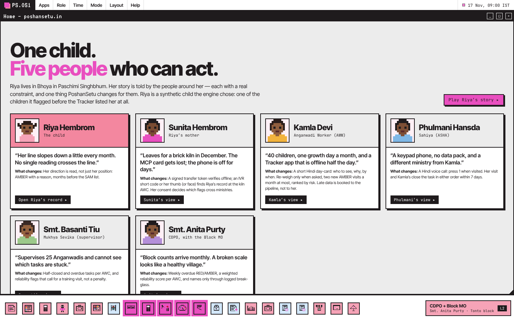 | 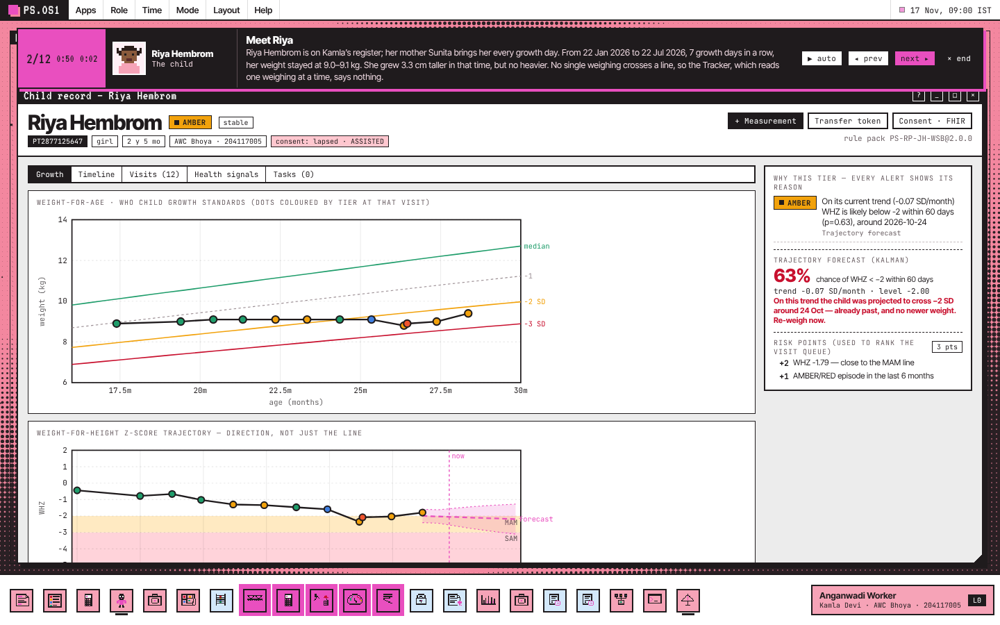 |

## The 10-minute presentation: Jury tour

Open **Layout → Jury tour** (or press `j`). It has 16 steps with timings and talking points on a caption bar. Use `→` / `←` to move. Each step opens the right window, sets the role and, where needed, runs the live demo (a RED-A event crossing the bridge).

## What is in the box

| Window | What it shows | Proposal / audit item |
|---|---|---|
| **Home** | Landing page, live silent-trial numbers, the five fixes | — |
| **Brief** | Round 2 storyline: problem (cited figures), ecosystem table, stakeholder personas, roadmap Gantt + feasibility, Table 5 impact | sections 1–6 |
| **Worklist** | Role-scoped tasks: tier, reason, event-time clock, escalation level, two-role closure, **risk-ranked queue** (explainable risk points), late-arrival and re-measure flags, CSV export; aggregate-only for DPO | 4.4, 4.6 |
| **Child record** | WHO weight-for-age curves, WHZ trajectory with a **Kalman forecast cone** (P(WHZ < −2 in 60 days)), risk points, timeline, MUAC, "why this tier", visits with ingest lag, consented vs withheld signals, break-glass | 4.2–4.4 |
| **AWW app (PWA)** | `app/pwa/`: installable, offline, **Hindi-first** phone app running the same engine: today's visits, weigh with live tier, reasons in Hindi, idempotent sync to the service (`POST /v1/device/events`). Opens from Home → "Then we made it smarter" | audit 1, 4.2 |
| **AWW phone** | Offline-first device: queue measurements with no signal, sync later — clocks still count from measurement; late data escalates on arrival | audit 1 |
| **Capture** | AWW entry with live preview of the rule outcome and entry-time validation (decimal-slip demo) | 4.2, 4.7 |
| **Map** | District → block → AWC, worst open task tier, reliability flags, k-anonymity above block | 4.6 |
| **Ladder** | Table 3 as code: L0 AWW/ASHA → L1 Mukhya Sevika → L2 CDPO+BMO → L3 DPO+CMO | 4.6 |
| **Bridge** | **Fix 01:** event bridge vs batch exports, clock-safety matrix, counterfactual replay, live in-flight events | audit 1 |
| **Joint visit** | **Fix 02:** asynchronous AWW + ASHA closure state machine, visit-window timeline, feature-phone IVR (DTMF 1–4) with **recorded Hindi prompts** (`app/assets/ivr/`); Santali, Ho and Mundari await native speakers | audit 2 |
| **Migration** | **Fix 03:** Ed25519 transfer token (QR + IVR short code) verified offline, tamper test, kiln scenario fallback ladder, Aadhaar eKYC / Face RD lookup, k-anonymous route notice | audit 3 |
| **R-score** | **Fix 04:** risk-weighted reliability vs the Round 1 equal-weight formula, calibration sliders, digit histograms, chronic-D logic | audit 4 |
| **Budget** | **Fix 05:** Rs 33 L pilot, what Rs 12 L actually buys, reuse of DPI blocks, per-child cost vs scale, Phase 3 capex line | audit 5 |
| **Consent** | ABDM consent artefacts, **HIE exchange in real ABDM v0.5 message shapes** (consent-requests/init → hip/notify → health-information/request → X25519 + HKDF + AES-GCM transfer → notify), NDGFP flag dictionary, DPDP timeline, revoke/renew with live re-triage, FHIR R4 bundle | 4.3, 4.7 |
| **Rule pack** | Dual-signed (MoWCD + MoHFW) versioned pack, calibration sliders, re-run the whole backtest, sign the draft as each ministry | design choice 5 |
| **Trial** | Silent-trial backtest: share of SAM flagged earlier, lead-time distribution, precision, a worked example. **Trade-off curve** (every threshold swept on 3 seeds, Pareto frontier, hover to compare, click to draft a rule pack) and **Ablation** (each rule kept only if it raised strict detection at ≥ 55% precision) | design choice 2, Table 5 |
| **Report** | Monthly district convergence report (L3), k-anonymous, print / save PDF | 4.6 |
| **Import** | Phase 1 tool: load an anonymised CSV export; the same signed rules run locally (tiers, reliability per AWC, lead vs single-reading lists); template download. Runs on **two real public SMART surveys** with a plausibility report (SMART digit-preference score, SD of WHZ, flagged values) | Table 4 Phase 1 |
| **Audit** | Session is an event journal, replayed on restart with an identical chain head. Hash-chained log of every view, capture, break-glass, consent and signing; tamper detection | 4.7 |
| **Architecture** | L1 → L4 diagram, where each block lives in the code, the three Theme 1 questions mapped to modules | 4.1 |
| **Shell** | `triage`, `tasks late`, `advance 2d`, `verify pack`, `verify audit`, `fhir`, `role` … | — |

Every window has a **?** button in its title bar that explains what to look at.

**Help → Export evidence pack** saves the signed rule pack, backtest metrics, reliability scores, bridge statistics and the full audit chain as JSON. Anyone can check it independently with `node scripts/verify-evidence.mjs <file>`.

Use the **Role** menu to switch between AWW, ASHA, Mukhya Sevika, CDPO and DPO. Views, name masking and counts change with the role. Use the **Time** menu (or `H` / `D` / `W`) to move the simulation clock and watch tasks escalate.

## Companion service (`server/index.mjs`)

The same engine runs headless behind the integration contracts a pilot would use. It has no dependencies (`node:http` + `node:crypto`) and is covered by `test/server.test.js`.

```bash
npm run service      # http://localhost:8080/health
```

| Endpoint | Purpose |
|---|---|
| `GET /v1/pack` | Signed rule pack (MoWCD + MoHFW signatures) |
| `POST /v1/hooks/growth-event` | Tracker webhook via API Setu; HMAC-SHA256 in `X-PS-Signature`; idempotent (duplicates acknowledged, not re-processed) |
| `POST /v1/sms` | RED flash from any phone: `PS RA <last-4 of beneficiary ref> <OED\|DNG\|MUC>` |
| `POST /v1/ivr/dtmf` | CPaaS callback when an ASHA presses 1–4 |
| `GET /v1/tasks?awc=&open=1` | Tasks with event-time escalation state (pseudonymous) |
| `GET /v1/children/:ref/fhir` | FHIR R4 WellnessRecord bundle, consent-gated, read logged |
| `GET /v1/tokens/:shortCode` | Transfer-token lookup by IVR short code |

## Engine (`app/engine/`, no dependencies, runs in Node and the browser)

- `growth.js`: WHO Child Growth Standards 2006 LMS z-scores (WAZ, HAZ, WHZ). Uses WHO's restricted method beyond ±3 SD and the 0.7 cm length/height adjustment. Also flags biologically implausible values (BIV). The tables in `who-lms.js` are generated by `scripts/build-who.mjs`.
- `velocity.js` + `who-velocity.js`: official WHO 2009 weight-velocity LMS(δ) tables (1- and 2-month increments, built by `scripts/build-velocity.py`); 490 published centiles reproduced to 1 g in `test/velocity.test.js`. `test/zscore-validation.test.js` checks z-scores against five public SMART surveys.
- `forecast.js`: Kalman local-linear-trend filter on monthly WHZ → probability of crossing −2 SD within the horizon.
- `risk.js`: explainable additive risk points, used for the WEAK_SIGNALS rule and for ranking the visit queue.
- `abdm.js`: the ABDM HIE consent and data-transfer flow with real cryptography (X25519 ECDH, HKDF-SHA256, AES-256-GCM).
- `importcsv.js`: CSV import, SMART survey detection and plausibility report.
- `triage.js`: Rules 1–3, RED-A/RED-B/AMBER/WATCH, infant and 12–24-month velocity on the WHO 2009 tables, Kalman forecast, combined weak signals, trend plus consented signal, two WATCH in a row become AMBER, same-day discrepancy, BIV quarantine, episode logic. Every result carries its reasons and the pack version.
- `rulepack.js` + `signing.js`: every threshold lives in a versioned pack signed with Ed25519 by both ministries (demo keys).
- `tasks.js`: tasks, two-role asynchronous closure, CMAM milestones for RED-B (appetite test and MO screening), the 2-per-AWC visit cap with ranked queue, and escalation on **measurement time** with late-arrival detection.
- `bridge.js`: adapters (API Setu webhook, SMS flash, batch export), lag models, clock-safety test, and an idempotent append-only event store with watermarks.
- `reliability.js`: weighted R-score (`R = 100 × (1 − min(1, 4·B + 1·F + 0.3·D·chronic))`). Digit preference is corrected for sample size, and the SMART digit-preference score (DPS) is reported for weight and height.
- `migration.js`: signed offline-verifiable tokens, Crockford short codes with a check character, registry lookup by short code or a salted UID-token hash (no Aadhaar numbers), recovery ladder, LTFU rule, and k-anonymous routes.
- `consent.js`, `fhir.js`, `audit.js`, `access.js`: consent artefacts and gating, FHIR R4 WellnessRecord bundles, the hash-chained audit log, and Table 3 decision rights.
- `simulate.js` (facade over `sim/constants.js`, `population.js`, `history.js`, `analyse.js`, `metrics.js`): a synthetic Paschimi Singhbhum pilot (3 blocks, 36 AWCs, 1,440 children, 12 months), tuned to NFHS-5 and NITI-IFPRI district levels. It includes migration, data-quality personalities, vaccines, consent, and an engine-in-the-loop re-measure. It also runs the silent-trial backtest.

## Honest limits

- Children, names and records are **synthetic**. Lead time and precision come from a simulation, not from field data. Phase 1 repeats the backtest on anonymised Tracker exports under a state agreement.
- The only real data are two cross-sectional SMART surveys (public, GPL-3 from nipnTK). No public longitudinal child-growth dataset exists, so trend rules are validated on simulation only.
- Hindi IVR audio is synthesised (espeak-ng); Santali, Ho and Mundari prompts need native speakers and are placeholders.
- The Poshan Tracker Open API, ABDM gateway, UIDAI eKYC, Bhashini and telecom calls are **simulated** behind the same interfaces a pilot would use.
- The signing keys are demo keys, published so anyone can verify signatures.

See `docs/PITCH_6MIN.md` for the 6-minute spoken pitch over the live prototype (word for word, covering every Round 2 judging item), `docs/DEMO_SCRIPT.md` for the 10-minute run-through and `docs/JURY_QA.md` for Q&A preparation.
